  

  

  סטודנטית שנה ג' למדעי המחשב ב־HIT, שאוהבת לבנות תוכנה שלמה ועובדת, ממסד הנתונים ועד העלייה לאוויר. 
  <b>מחפשת משרת סטודנט בהנדסת תוכנה.</b>

  
  

<h2 align="center"> Okeat</h2>

  <b>OK to eat.</b> מפה דו־לשונית של יותר מ־20,000 מקומות אוכל כשרים, טבעוניים, צמחוניים וללא גלוטן בכל הארץ, 
  עם כללי אימות וניהול שנאכפים בתוך מסד הנתונים עצמו.

  

  
  

  <code>Next.js 15</code> · <code>React 19</code> · <code>TypeScript</code> · <code>PostgreSQL + PostGIS</code> · <code>Supabase</code> · <code>Mapbox GL</code> · <code>Tesseract OCR</code> · <code>Claude API</code> · <code>GitHub Actions</code>

<h2 align="center"> DiviStay</h2>

  <b>מזמינים יחד, כל אחד משלם לבד.</b> הזמנת מלון קבוצתית עם פיצול תשלום, 
  מתכנון UML וארכיטקטורה ועד אתר חי.

  

  
  

  <code>Java 21</code> · <code>Spring Boot 3</code> · <code>Thymeleaf</code> · <code>JUnit 5</code> · <code>Docker</code> · <code>Render</code> · <code>UML</code> · <code>Design Patterns</code>

  
  

<table>
  <tr valign="top">
    <td width="50%" align="center"> <b><a href="https://github.com/NoyaAdivi/okeat-lens/blob/main/README.he.md">📸 Okeat Lens</a></b> מודל לזיהוי 101 מנות מתמונה <code>Python · PyTorch · ONNX · FastAPI</code></td>
    <td width="50%" align="center"> <b><a href="https://github.com/NoyaAdivi/LeakLens/blob/main/README.he.md">🔐 LeakLens</a></b> REST API לבדיקת סיסמאות ששומר על הפרטיות <code>Python · FastAPI · Docker</code></td>
  </tr>
  <tr valign="top">
    <td width="50%" align="center"> <b><a href="https://github.com/NoyaAdivi/splitship/blob/main/README.he.md">🚢 SplitShip</a></b> API לחלוקת חשבון עם CI/CD מלא <code>Node.js · Docker · GitHub Actions</code></td>
    <td width="50%" align="center"> <b><a href="https://github.com/NoyaAdivi/photo-twins/blob/main/README.he.md">👯 Photo Twins</a></b> מוצא תמונות כפולות ודומות <code>Python · Perceptual Hash · BK-tree</code></td>
  </tr>
  <tr valign="top">
    <td width="50%" align="center"> <b><a href="https://github.com/NoyaAdivi/nudgy-bot/blob/main/README.he.md">🔔 Nudgy</a></b> בוט טלגרם דו-לשוני שמזכיר דדליינים <code>Python · Telegram API · SQLite</code></td>
    <td width="50%" align="center"> <b><a href="https://github.com/NoyaAdivi/FocusBloom/blob/main/README.he.md">🌸 FocusBloom</a></b> תוסף כרום של פומודורו שחוסם הסחות דעת <code>JavaScript · Manifest V3</code></td>
  </tr>
</table>

  

  
  

<b>שפות</b> 

<b>ווב ושרתים</b> 

<b>מסדי נתונים וענן</b> 

<b>נתונים ולמידת מכונה</b> 

<b>כלים</b> 

  
  

  
  &nbsp;
  

