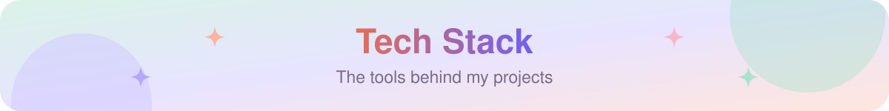

  

  

  3rd-year Computer Science student at HIT who enjoys building complete, working software - from database to deployment. 
  <b>Looking for a Software Engineering student position.</b>

  
  

<h2 align="center"> Okeat</h2>

  <b>OK to eat.</b> A bilingual map of 20,000+ kosher, vegan, vegetarian and gluten-free eateries across Israel, 
  with verification and moderation rules enforced inside the database.

  

  
  

  <code>Next.js 15</code> · <code>React 19</code> · <code>TypeScript</code> · <code>PostgreSQL + PostGIS</code> · <code>Supabase</code> · <code>Mapbox GL</code> · <code>Tesseract OCR</code> · <code>Claude API</code> · <code>GitHub Actions</code>

<h2 align="center"> DiviStay</h2>

  <b>Book together, pay separately.</b> Group hotel booking with payment splitting, 
  taken from UML and architecture to a live demo.

  

  
  

  <code>Java 21</code> · <code>Spring Boot 3</code> · <code>Thymeleaf</code> · <code>JUnit 5</code> · <code>Docker</code> · <code>Render</code> · <code>UML</code> · <code>Design Patterns</code>

  
  

<table>
  <tr valign="top">
    <td width="50%" align="center"> <b><a href="https://github.com/NoyaAdivi/sort-photos">🖼️ Sort Photos</a></b> Offline AI photo classifier with CLIP <code>Python · PyTorch · CLIP</code></td>
    <td width="50%" align="center"> <b><a href="https://github.com/NoyaAdivi/emotion_detection_ml">🎭 Emotion Detection</a></b> Naive Bayes from scratch for 6 emotions <code>Python · Scikit-Learn</code></td>
  </tr>
  <tr valign="top">
    <td width="50%" align="center"> <b><a href="https://github.com/NoyaAdivi/Networking-project">💬 TCP Chat</a></b> Multi-client chat with Wireshark analysis <code>Python · Sockets · Wireshark</code></td>
    <td width="50%" align="center"> <b><a href="https://github.com/NoyaAdivi/HaMivchanon">📱 HaMivchanon</a></b> Android study app with smart reminders <code>Java · Android · Firebase</code></td>
  </tr>
</table>

  

  
  

<b>Languages</b> 

<b>Web &amp; Backend</b> 

<b>Databases &amp; Cloud</b> 

<b>Data &amp; ML</b> 

<b>Tools</b> 

  
  

  
  &nbsp;
  

